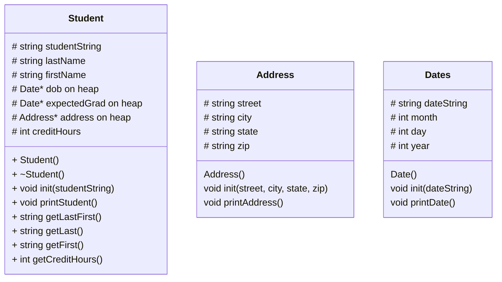

# 121Lab-StudentHeap

## UML


## Address::Address()
```
set street to NA
set city to NA
set state to NA
set zip to NA
```

## Address::init(string street, string city, string state, zip)
```
set Address::street to street
set Address::city to city
set Address::state to state
set Address::zip to zip
```

## Address::printAddress()
```
print street, city, state, zip
```

## Date::Date()
```
set month to 0
set day to 0
set year to 0
set dateString to NA
```

## Date::init(dateString)
```
set Date::dateString to dateString
```

## Address::printDate()
```
print Date::dateString
```

## Student::Student()
```
initialize variables w/ placeholders
```

## Student::~Student()
```
delete Date* dob
delete Date* expectedGrad
delete Address* address
```

## Student::init(studentString)
```
set Student::studentString to studentString
set strings through ss
set dob, expectedGrad, and address
convert creditHours to int
```

## Student::printStudent()
```
print all student info (first and last name, dob, etc.)
```

## Student::getLastFirst()
```
return lastName firstName
```

## Student::setCredits(creditHours)
```
set Student::creditHours to creditHours
```

## Student::getLastName
```
return lastName
```

## Student::getFirstName
```
return firstName
```

## Student::getCreditHours
```
return creditHours
```

# main functions

## int main()
```
pre-define main classes
create a vector of Student pointers called students
call loadStudents to load the vector from the file

set keepGoing to true
while keepGoing:
  call menu function to get string response
  if response is "0":
    go to delStudents - ref to students
    set keepGoing to false
  if response is "1":
    go to allStudentNames - ref to students
  if response is "2"
    go to printStudents - ref to students
  if response is "3":
    go to findStudent - ref to students
  if any other number:
    prompt user to try again with a number between 0-3
return 0
```

## std::string menu()
```
create a string variable named userChoice
prompt user to choose whether to quit (0), print all student names (1), print all student data (2),
or find a student (3)
record user's input into userChoice
return userChoice
```

## void loadStudents(std::vector<Student*>&)
```
create ifstream
create stringstream named ss
create a string for currentLine
open students.csv to read line into currentLine

while lines can still be read into currentLine:
  clean stringstream
  put the currentLine into stringstream
  create a new student on heap
  initialize student w/ currentLine
  put that student to the back of the student vector
close the students.csv file
```

## void printStudents(std::vector<Student*>&)
```
for each student in the Student vector:
  call Student::printStudent()
```

## void allStudentNames(std::vector<Student*>&)
```
for each student in the Student vector:
  call Student::getLastFirst()
```

## void findStudent(std::vector<Student*>&)
```
ask the user to input a last name
put user's input into a string named userInput
for each student in the Student vector:
  run string.find(userInput) for the Student's last name
  put that result into a variable named result
  if the result did not return std::string::npos
    call Student::printStudent()
```

## void delStudents(std::vector<Student*>&)
```
for each student in the Student vector:
  delete Student()
```
